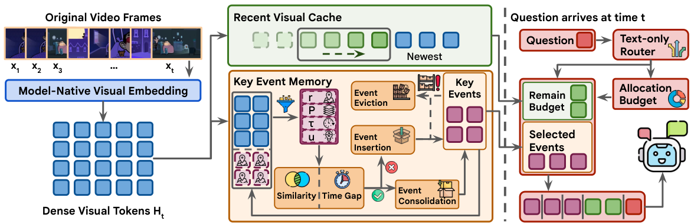

# KeyRec

### Bounded Visual Memory for Streaming and Long-Video Understanding

KeyRec is a training-free visual memory for streaming and long-video understanding.
It maintains a recent-token cache and a bounded bank of past events, then selects
visual evidence for each question using a query-adaptive readout.



## Highlights

- **Bounded memory:** update visual memory as frames arrive, without retaining the full visual history.
- **Question-adaptive retrieval:** combine recent context with complete event payloads, preserving temporal order.
- **Compact readout:** expose approximately **10%** of the dense visual tokens to the decoder; persistent candidate memory is approximately **20%**.
- **Three backbones, four benchmarks:** Gemma 4 E2B/E4B and NEO-ov 2B on OVO-Bench, StreamingBench, LongVideoBench, and Video-MME-v2.

KeyRec selects model-facing visual tokens. The Gemma implementation still runs
the vision encoder on sampled frames.

## Installation

Use Linux with an NVIDIA GPU for model evaluation. Run commands from the
repository root. Model weights and benchmark data are downloaded separately.

### Gemma

The Gemma environment uses Python 3.12 and the committed `uv.lock`.
Install [uv](https://docs.astral.sh/uv/getting-started/installation/), then:

```bash
# Download the pinned evaluation dependency (works after extracting this ZIP).
python3 scripts/setup_third_party.py
uv sync --frozen

# Keep model/data caches outside the source checkout.
export STREAMING_VU_STORAGE_ROOT="$HOME/.cache/keyrec"
```

The setup script fetches VLMEvalKit at a fixed commit and preserves any existing
checkout. Do not run `pip install -U` over the locked environment.

### NEO-ov

NEO uses a separate Python 3.10 environment and Torch/Transformers stack.
Follow the [NEO environment instructions](environments/README.md#neo-ov-profile).
The supplied NEO snapshot has documented dependency conflicts; those details and
the exact installation command are kept in that guide.

## Quick start

### 1. Inspect the evaluation plan

```bash
.venv/bin/python -m gemma4_video_eval.main_result_eval --format json
```

This prints **24 commands**: 3 backbones × 2 methods (vanilla and KeyRec) × 4
benchmarks. It does not download checkpoints or start a GPU job.

### 2. Prepare models and data

Download the checkpoints named in [`configs/main_results.yaml`](configs/main_results.yaml)
and prepare the dataset layouts in the [evaluation guide](evaluation/README.md#dataset-layouts).
Use local snapshot paths for reproducible runs.

### 3. Run a small example

After setting the two paths below, run one LongVideoBench sample with Gemma E2B:

```bash
export GEMMA_E2B_SNAPSHOT=/path/to/gemma-e2b/snapshots/MODEL_COMMIT
export LONGVIDEOBENCH_ROOT=/path/to/longvideobench/snapshots/DATASET_COMMIT

.venv/bin/python -m gemma4_video_eval.longvideobench_eval \
  --backend keyrec \
  --model-path "$GEMMA_E2B_SNAPSHOT" \
  --longvideobench-root "$LONGVIDEOBENCH_ROOT" \
  --output /tmp/keyrec-longvideobench \
  --num-frames 64 \
  --sampling linspace \
  --max-soft-tokens 70 \
  --read-policy llm_router \
  --max-samples 1
```

Remove `--max-samples 1` for the full split. Use a new output directory for each
run. The [evaluation guide](evaluation/README.md) includes all four datasets,
command planning, output formats, and optional run manifests.

## Main results

Compressed methods use a matched
approximately 10% decoder-facing visual-token budget. **Bold** marks the best
compressed result in each row, including ties; “—” denotes an unsupported
architecture. STOM-CTR abbreviates StreamingTOM-CTR.

| Benchmark | Backbone | Subset | Vanilla | STC-Pruner | STOM-CTR | CausalMem | KeyRec |
|---|---|---|---:|---:|---:|---:|---:|
| OVO-Bench | Gemma 4 E2B | Backward | 43.22 | 41.20 | 42.30 | **45.31** | 43.83 |
| OVO-Bench | Gemma 4 E2B | Realtime | 50.72 | 48.02 | 47.23 | 55.49 | **57.70** |
| OVO-Bench | Gemma 4 E4B | Backward | 53.86 | 53.01 | 50.49 | **54.45** | **54.45** |
| OVO-Bench | Gemma 4 E4B | Realtime | 59.83 | 51.67 | 53.26 | 62.51 | **64.81** |
| OVO-Bench | NEO-ov 2B | Backward | 38.66 | 35.22 | — | 39.09 | **41.90** |
| OVO-Bench | NEO-ov 2B | Realtime | 58.07 | 36.84 | — | 44.41 | **62.78** |
| StreamingBench | Gemma 4 E2B | Realtime | 51.28 | 52.91 | 51.36 | 58.01 | **61.29** |
| StreamingBench | Gemma 4 E4B | Realtime | 63.73 | 56.44 | 60.25 | 63.61 | **66.49** |
| StreamingBench | NEO-ov 2B | Realtime | 69.06 | 50.68 | — | 55.56 | **69.10** |
| LongVideoBench | Gemma 4 E2B | Validation | 35.90 | 33.06 | 34.64 | 34.11 | **35.60** |
| LongVideoBench | Gemma 4 E4B | Validation | 49.14 | 43.38 | 43.98 | 43.08 | **45.77** |
| LongVideoBench | NEO-ov 2B | Validation | 52.51 | 44.43 | — | 42.93 | **49.29** |
| Video-MME v2 | Gemma 4 E2B | Overall | 18.47 | 14.16 | **15.69** | 15.31 | 15.41 |
| Video-MME v2 | Gemma 4 E4B | Overall | 20.09 | 14.34 | 15.91 | 14.84 | **17.63** |
| Video-MME v2 | NEO-ov 2B | Overall | 22.06 | 17.56 | — | 17.47 | **20.03** |

KeyRec achieves the best compressed result in **13 of 15** settings, including
ties.

## Code map

| Path | Purpose |
|---|---|
| `src/keyrec/` | Bounded event memory, recent cache, readout, and backbone adapters |
| `models/keyrec_gemma.py` | Gemma KeyRec wrapper |
| `models/keyrec_neo.py` | NEO-ov KeyRec wrapper |
| `benchmarks/` | Dataset loading, inference, and scoring |
| `gemma4_video_eval/` | Evaluation CLIs, command planner, and run metadata |
| `configs/main_results.yaml` | Default memory profiles and evaluation matrix |
| `tests/` | Memory, adapter, config, and evaluation tests |

The public CLI names `keyrec` (Gemma E2B/E4B) and `keyrec_neo` (NEO-ov 2B)
select the implementation in `src/keyrec/`. The default read policy is
`llm_router`; use `--read-policy` to select one of the five fixed router states.

See [method details](docs/method.md),
[limitations](docs/known_limitations.md), and [test instructions](tests/README.md).

## Acknowledgments

We thank the developers of Gemma, NEO, OVO-Bench, StreamingBench, LongVideoBench,
Video-MME-v2, VLMEvalKit, STC, CausalMem, and StreamingTOM.
Retained third-party source and license notices are listed in
[THIRD_PARTY_NOTICES.md](THIRD_PARTY_NOTICES.md).
